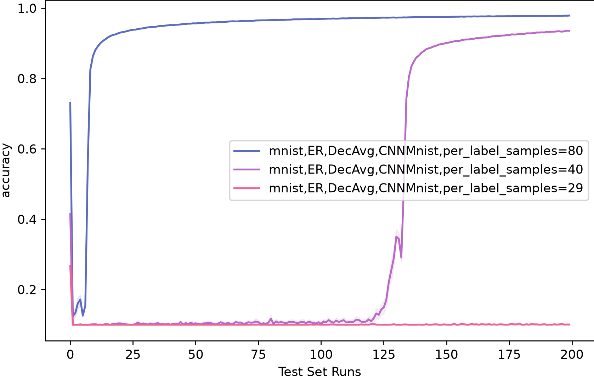

# Independent-init collapse

This example reproduces the **initial collapse** of decentralized learning. When nodes start from *independently initialized* models, averaging them with their neighbors pushes accuracy down to chance level. The network stays there for a while, and then escapes and converges.



## Setup

| | |
|---|---|
| Dataset | MNIST, IID partitioning, 20% of each node's samples held out for validation |
| Topology | Erdős–Rényi, 50 nodes, `p=0.5` |
| Initialization | Independent (`common_init: false`), no initial exchange |
| Aggregation | DecAvg, weighted, including the node's own model |
| Model | `CNNMnist` |
| Local training | SGD (lr 3e-3, momentum 0.9), 8 epochs, batch size 32, no early stopping |
| Comm. rounds | 200 |

The three experiments differ only in `max_per_label_samples`. Experiment names follow the pattern `mnist,ER,DecAvg,CNNMnist,per_label_samples=<n>`, where `<n>` is the number of *training* samples per label.

The effect is strongest with a dense graph and moderately strong local training. On a sparse graph (e.g. Barabási–Albert with `m=1`), lr 3e-3 repairs the averaged model within one round and there is no visible dip. Adam, more epochs or smaller batches have the same effect.

## What's in this folder

| File | Content |
|------|---------|
| [`main.py`](main.py) | Experiment definitions and the `VanillaDecentralizedSynchWithoutPreConsensus` scenario. |
| [`core.yml`](core.yml) | Callbacks: per-round confusion matrices and losses. |
| [`colors.yaml`](colors.yaml) | Line colors for the comparison plot. |
| [`experiments_comparison_plot.png`](experiments_comparison_plot.png) | Mean test accuracy across nodes per communication round. |

## Running

Run all commands from this directory, since `core.yml` is loaded through a relative path.

```bash
# Validate the configs and dump them to experiments_configs.json
python main.py --sanity_check

# Run all three experiments, in parallel
python main.py --concurrent_runs 3

# Run only one of them
python main.py --experiment_name_filter "per_label_samples=80"
```

### Parallel run (free-threaded Python)

> [!IMPORTANT]
> This requires a free-threaded (GIL-free) build of Python 3.13 or later, e.g. `python3.13t` or `python3.14t`. The parallel clients run as threads in a single process. On a standard build they all share the GIL, so the run still works but gets no speedup.

To reproduce the plot:

```bash
PYTHON_GIL=0 python main.py --seed 123 --num_parallel_clients 50 --concurrent_runs 3
```
